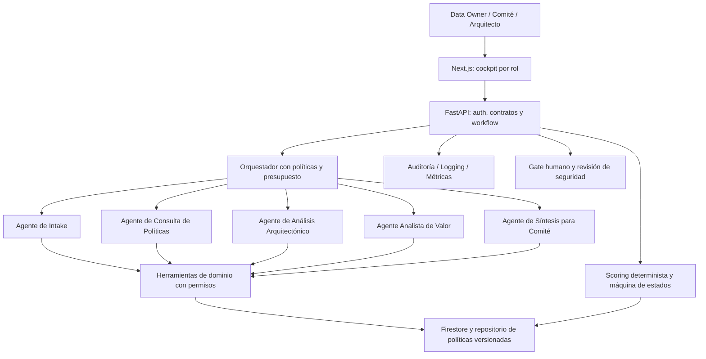

# SDD 01 — Arquitectura agéntica asistida
**Estado: propuesta académica**. Referencia de implementación existente: portafoliodatagob (no se copia ni presume paridad total).

## 1. Capas

## 2. Catálogo de agentes y límites
| Agente | Entrada | Salida estructurada | Herramientas permitidas | Prohibido |
|---|---|---|---|---|
| AG-01 Intake | Mensaje + perfil usuario | DemandaDraft, pendientes, preguntas | read_catalog, propose_demand | Enviar a comité sin confirmación |
| AG-02 Políticas/RAG | Demanda + policy_version | policy_checks con fuente/versión y brechas | search_policies, evaluate_rules | Declarar cumplimiento legal definitivo |
| AG-03 Arquitectura | ProposedArchitecture + catálogo | brechas, riesgos, recomendaciones | read_architecture_pattern | Provisionar GCP o autorizar excepciones |
| AG-04 Valor | Inputs financieros confirmados | supuestos/insights y solicitudes de datos | calculate_metrics (determinista) | Inventar flujos, score o aprobar inversiones |
| AG-05 Comité | Estado + evidencia | borrador decision_packet | read_demand, read_audit, explain_score | Registrar decisión de comité por su cuenta |

Cada salida requiere `agent_run_id`, `model_version`, `confidence_label` cualitativa, `sources[]`, `warnings[]` y `requires_human_review`. Una confianza numérica del modelo no equivale a probabilidad estadística calibrada.

## 3. Orquestación de mínimo privilegio
1. API valida OIDC JWT, RBAC, tenant y quota.
2. Orquestador selecciona subagente por tarea permitida; solo lectura salvo draft propuesto.
3. Instrucciones del usuario y fuentes RAG son datos no confiables; herramientas nunca se eligen por prompt externo sin autorización.
4. Agentes producen JSON validado con schema y citan evidencia versionada.
5. Policy Engine verifica acciones y deniega por defecto; cambios persistentes pasan por endpoints autorizados.
6. Servicio agrega evento de auditoría y correlación.
7. Humano confirma demanda, score, recomendación y decisión de gate.

## 4. Ciclo de estados (sin saltos)
`DRAFT → SUBMITTED → IN_REVIEW → NEEDS_INFO | RECOMMENDED | REJECTED → PRIORITIZED → APPROVED | DEFERRED | REJECTED`.
Opciones condicionales son transiciones permitidas desde estados definidos en el servicio, jamás por salida directa del LLM. Todo cambio requiere `actor_id`, `role`, `reason`, `version` y `idempotency_key`; versiones incompatibles dan HTTP 409.

## 5. RAG gobernado
Repositorio de políticas estructuradas con `policy_id`, versión, ámbito, fecha y vigencia. Recuperación filtrada por rol y tenant; top-k limitado, evidencias con anchors, clasificación de cobertura (completa/parcial/nula), abstención cuando no hay contexto; adversarial tests de prompt injection y datos falsos. No se declara que GraphRAG forme parte del alcance del curso.

## 6. Seguridad y guardrails
- Prevención prompt injection / tool injection, PII en prompts, fuga cross-tenant, excesos de herramientas, manipulación del scoring y salidas engañosas.
- No permitir ejecutar comandos, crear recursos, aprobar demandas, modificar score o desplegar usando una instrucción conversacional.
- Presupuesto por invocación y tenant: cuota, conteo de tokens, costo acumulado, timeouts/retry limitado y circuit breaker.
- Telemetría: tokens in/out, latencia, agente, modelo, coste estimado, errores, tasa de abstención y override humano; no registrar prompts con PII en bruto.
- Versionar prompts/guardrails y datasets de evaluación.
- Fallback: formulario manual y revisión humana si Gemini no está disponible.

## 7. Diseño GCP
Cloud Run web/API con service accounts separadas; Firestore para piloto, IAM y Secret Manager; Cloud Logging/Monitoring y trazas; modelo Gemini invocado vía servicios autorizados en GCP. IdP OIDC corporativo *existente* se integra, no se implementa. Datos sintéticos por defecto. Configuraciones, permisos y recursos productivos condicionados a revisión técnica/seguridad.

## 8. Riesgos agénticos
| Riesgo | Mitigación | Evidencia |
|---|---|---|
| Alucinación de política | RAG con referencia, abstención y revisión | Evaluación AG-02 |
| Acción sin autorización | RBAC server side + deny-by-default | Test permisos |
| Prompt injection | Entradas externas aisladas del system policy | Test adversarial |
| Exposición de datos | Redacción/tenancy/retención | Test privacidad |
| Costo fuera de presupuesto | cuotas/tokens/alertas | Dashboard FinOps |
| Agente falla o Gemini cae | fallback y SLA de aviso | Test resiliencia |
