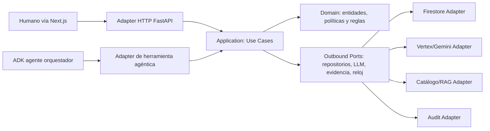

# SDD 05 — Arquitectura de software: Hexagonal Slice (ADR-002)
**Estado:** decisión de arquitectura objetivo, pendiente verificación de conformidad del código fuente. **Proyecto:** ATLAS DataGob UPN · **Duración:** 6 semanas.

## 1. Decisión y origen
Se adopta **Hexagonal Slice Architecture** (Vertical Slice + Ports & Adapters), conforme al patrón [DevPattern Hexagonal Slice](https://github.com/JuliusCordova/DevPattern/blob/main/patterns/architecture/hexagonal-slice/README.md) y al [marco de selección progresiva](https://github.com/JuliusCordova/DevPattern/blob/main/patterns/architecture/decision-framework.md). El uso de ADK, Cloud Run y Gemini proviene de [DevPattern GCP](https://github.com/JuliusCordova/DevPattern/blob/main/agentic-reference-architectures/gcp.md). La adaptación es **propuesta de arquitectura objetivo** y no evidencia de refactor realizado en el producto.

**Justificación:** ATLAS presenta reglas críticas de dominio (comité, puntuación, permisos, estados y auditoría), múltiples herramientas/agentes y dependencias externas sustituibles; necesita pruebas sin GCP y gobierno de acciones. Aplicar el patrón progresivamente, no multiplicar interfaces artificiales.

## 2. Hexágono de cada capacidad


**Regla de dependencias:** Domain no importa FastAPI, Google SDK, Firestore, ADK ni frameworks web. Application depende de Domain y puertos definidos por la propia slice. Adapters dependen de esas interfaces, no al revés. Un agente es normalmente adaptador de entrada u orquestador; su prompt **no** contiene las reglas definitivas del scoring, control de acceso o aprobación. No hacer bypass de Application desde tools/agents hacia bases de datos para cambiar decisiones.

## 3. Slices del dominio
| Slice / bounded capability | Use cases y entidades | Puertos necesarios (justificados) | Adaptadores GCP |
|---|---|---|---|
| intake | create_demand, suggest_draft, submit; Demand | DemandRepository, LLMProposalPort, AuditPort | Firestore, Gemini, Logging |
| governance | evaluate_policy, evaluate_architecture; Gap, PolicyCheck | PolicyCatalogPort, ArchitecturePatternPort | repositorio versionado + adaptador de búsqueda |
| committee | recommend, record_decision; CommitteeDecision | DecisionRepository, AuditPort | Firestore, Logging |
| scoring | calculate_score, calculate_financials; Score | ScoreRepository (solo persistencia), Clock | Firestore, reloj |
| portfolio | list_backlog, get_dashboard; PortfolioView | PortfolioQueryPort | consultas Firestore; BigQuery **no requerido** por MVP |
| identity | authorize_action; Actor, Permission | IdentityClaimsPort | OIDC JWT validado y middleware IAM |
| release | evaluate_gate; GateDecision | EvidencePort, ReleaseRecordPort | GCS opcional para evidence pack; Firestore |
| shared | IDs, errores tipados, telemetry context | solo interfaces realmente compartidas | Logging/Monitoring |

**Separación de dominios:** ATLAS administra demanda/portafolio y no ejecuta pipelines productivos DataOps; respeta [ADR fuente](https://github.com/JuliusCordova/portafoliodatagob/blob/main/docs/adr/ADR-0001-separacion-dataops.md).

## 4. Organización sugerida del código (objetivo; no implica que exista hoy)
```text
apps/
  api/
    src/atlas_datagob/
      features/
        intake/
          domain/{entities.py,rules.py}
          application/{use_cases.py,commands.py}
          ports/{demand_repository.py,llm_proposal.py}
          adapters/inbound/{http.py,agent_tools.py}
          adapters/outbound/{firestore.py,gemini.py}
          tests/{unit,contract,integration,evals}/
        governance/
          domain/ application/ ports/ adapters/ tests/
        committee/
          domain/ application/ ports/ adapters/ tests/
        scoring/
          domain/ application/ ports/ adapters/ tests/
        portfolio/
          domain/ application/ ports/ adapters/ tests/
        release/
          domain/ application/ ports/ adapters/ tests/
      bootstrap/{container.py,settings.py}
      shared/{errors.py,auth_context.py,telemetry.py}
  web/
    src/  # Next.js: componentes y rutas por features
```
Los límites hexagonales son conceptuales al comenzar; evitar migración masiva del código solo para reorganizar carpetas. Refactorizar **una slice piloto** (intake o scoring), demostrar tests con adaptadores falsos y luego decidir ampliación.

## 5. Secuencias de confianza
- Entrada HTTP: token OIDC validado → claims de tenant/rol → comando con idempotency_key → use case → policy guard determinista → repositorio.
- Entrada agente ADK: prompt externo no confiable → tool schema validado → autorización contextual → use case → respuesta tipada → confirmación humana.
- Scoring: el agente sugiere contexto, **ScoreService del dominio** calcula con parámetros aprobados, registra versión/hash y ofrece explicaciones.
- Comité: solo rol autorizado puede persistir decisión; historial append-only con razón/actor.
- Release: evidencia técnica + decisiones humanas; el agente no firma ni promueve.

## 6. Contratos de interfaces (pseudocódigo Python)
```python
from typing import Protocol

class DemandRepository(Protocol):
    async def get(self, demand_id: str, tenant_id: str): ...
    async def save(self, demand, expected_revision: int, idempotency_key: str): ...

class PolicyCatalogPort(Protocol):
    async def list_applicable(self, domain: str, tenant_id: str, version: str): ...

class LLMProposalPort(Protocol):
    async def propose_draft(self, messages: list[dict], policy_context: list[dict]): ...

class AuditPort(Protocol):
    async def append(self, event): ...
```
Puertos para integraciones externas, no para aritmética o entidades internas. Los tests de dominio usan fakes; los contract tests verifican adapters reales sin suponer su comportamiento.

## 7. Riesgos y decisiones explícitas
- No adoptar microservicio por agente ni GKE solo por el patrón: MVP inicial en Cloud Run web/API y módulos internos.
- No duplicar orquestación empresarial: ADK coordina tareas; políticas y permisos son código verificable en dominio/aplicación.
- No confundir arquitectura de evaluación **Sources→Bronze→Silver→Gold** del portafolio con la arquitectura interna del producto.
- Evitar estado mutable solo en memoria de Cloud Run: Firestore con revisiones, idempotencia y procesos recuperables.
- Registrar refactor en historias y ADR; pruebas y evidencia antes de promover.

## 8. Criterios arquitectónicos de aceptación
ARCH-01: pruebas de reglas críticas no importan SDKs GCP. ARCH-02: cambio de Firestore por fake no cambia caso de uso. ARCH-03: cambio Gemini por fake no cambia scoring/comité. ARCH-04: agentes no persisten decisiones. ARCH-05: RBAC server-side y aislamiento tenant en todos puertos de datos. ARCH-06: contratos/versionado y e2e con evidencia. ARCH-07: coste/latencia instrumentados. ARCH-08: una slice piloto demuestra puertos/adaptadores y tests.
