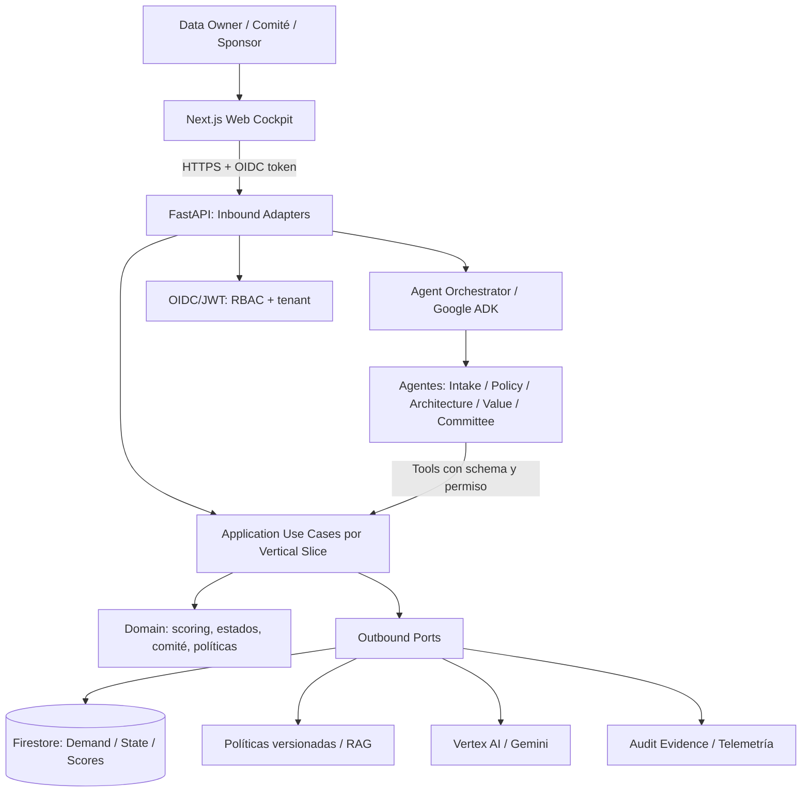
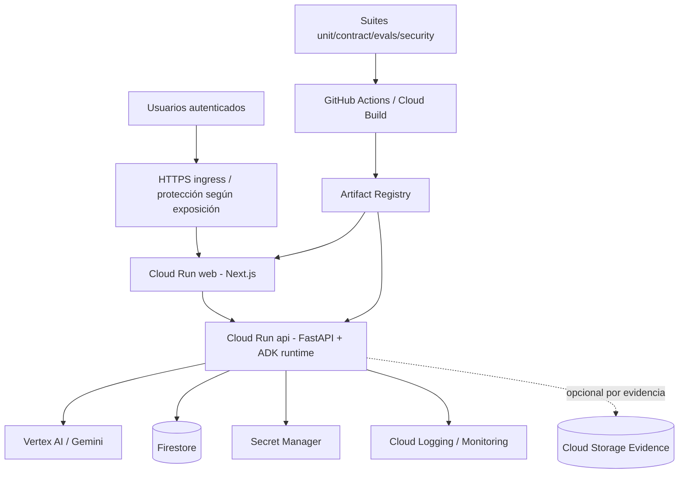
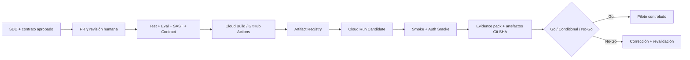

# SDD 06 — Arquitectura de componentes e infraestructura en Google Cloud (ADR-003)
**Baseline seis semanas | MVP de implantación simulado.** Distinguir servicios reales de referencia, componentes seleccionados y futuras extensiones. Alineado a [DevPattern GCP](https://github.com/JuliusCordova/DevPattern/blob/main/agentic-reference-architectures/gcp.md), [prácticas probadas](https://github.com/JuliusCordova/DevPattern/blob/main/patterns/implementation-profiles/gcp/proven-practices.md) y [ATLAS técnico](https://github.com/JuliusCordova/portafoliodatagob/blob/main/docs/specs/09-mvp-agentic-architecture.md).

## 1. C4 nivel 2: componentes de software

Agentes especializados son componentes **lógicos** y no cinco servicios desplegados. Las acciones sensibles requieren caso de uso autorizado y aprobación humana.

## 2. C4 nivel 3 / despliegue físico GCP

**Seleccionado MVP:** Cloud Run web y API, Firestore, Vertex AI/Gemini para agentes, IAM/service account dedicada, Secret Manager, Logging/Monitoring, Artifact Registry y pipeline de construcción. Google ADK se utiliza cuando lo respalde el runtime existente y las pruebas; si no, registrar brecha de implementación. **Condicional:** GCS para evidencias (según volumen y seguridad). **Fuera de baseline salvo justificación:** Pub/Sub, Eventarc, Cloud SQL, BigQuery, GKE, VPC compleja, PSC y worker pools. Si el producto técnico incluye algunos de ellos como arquitectura futura, **no significa** que se desplieguen en estas seis semanas.

## 3. Matriz de responsabilidades
| Componente | Responsabilidad | Seguridad / control | Evidencia |
|---|---|---|---|
| Next.js en Cloud Run | Intake, comité, tablero, feedback | sesiones, no secretos, UI por rol | smoke UI |
| FastAPI en Cloud Run | contratos, autorización, casos de uso | JWT verificado, tenant, rate-limit, idempotencia | API/contract tests |
| Google ADK runtime | orquestar herramientas/razonamiento | tool allowlist, cuotas, max steps, human review | agent evals |
| Vertex AI / Gemini | comprensión, síntesis, propuestas | modelo/config versionada, minimización de contexto | traces redactadas |
| Firestore | demandas, scores, decisiones y eventos | IAM least privilege, transacciones, revisión optimista | integration tests |
| Políticas versionadas | fuentes y reglas de compliance | ACL, versión, fuente/cita | policy test |
| Secret Manager | secretos configurados | acceso por service account | IAM review |
| Logging/Monitoring | auditoría técnica, latencia, errores y costos | redacción de PII, trace_id | dashboard |
| Artifact Registry / CI | imágenes trazables y reproducibles | scans, pin SHA/digest, separación ambientes | build/release record |
| Cloud Storage (condicional) | paquetes de evidencia y documentos | IAM, retención, validación archivos | evidence pack |

## 4. Flujo de una demanda
1. Usuario ingresa desde web; API valida OIDC, claims y tenant.
2. Intake assistant pregunta, estructura y sugiere campos, nunca envía sin confirmación.
3. Caso de uso persiste borrador y auditoría en Firestore con revisión.
4. Policy/Architecture agents recuperan reglas/versiones; devuelven brechas, citas y flags para revisión humana.
5. Servicio determinista calcula scoring; comité autorizado registra decisión.
6. Backlog y tablero muestran estado y evidencia filtrados por permisos.
7. En semana 6, desplegar candidate, smoke estándar/autenticado, UAT, evidence pack y gate humano ficticio.

## 5. GCP: ambientes y controles mínimos
**Ambientes objetivo:** dev/test controlado y candidate/piloto, con aislamiento de datos, recursos/credenciales y configuración; un tercer prod enterprise es fuera de alcance salvo recursos existentes y autorización formal. GCP project IDs no deben hardcodearse en SDD. Identidad de runtime distinta de identidad de despliegue; API privada o protegida según arquitectura de acceso. Nunca confiar solo en ocultar botones web; enforce API.
**Seguridad:** OIDC JWT, RBAC tenant, mínima exposición, Secret Manager, TLS, IAM, auditoría de eventos, límites de invocaciones Gemini, restricción de acceso a Firestore y registros sin PII.
**Fiabilidad:** timeout, retry con backoff e idempotencia en operaciones write, health/readiness, caída de modelo con fallback humano, policy retrieval con abstención.
**FinOps:** labels de entorno/proyecto, budget alert, cuotas del runtime/LLM, costo por resultado aprobado y monitoreo; métricas como objetivos hasta medirlas.

## 6. CI/CD y promoción

Guardar commit SHA, digest de imagen, build ID, Cloud Run revision, spec/prompt/model version y evidencia. No afirmar un deployment de esta arquitectura sin verificar recursos y ejecución.

## 7. Evolución fuera de las seis semanas
BigQuery analítica si volumen/reporting lo justifica; Pub/Sub/Eventarc por desacoplamiento demostrado; Cloud Run Jobs para evaluaciones batch; Worker Pools solo procesos persistentes; Cloud SQL si relaciones/transacciones exigen esquema relacional; Vector Search/GraphRAG si recuperación y evaluación prueban valor; Apigee si políticas enterprise lo ameritan. **No introducir solo por apariencia de arquitectura enterprise.**

## 8. Control académico
EDT 2.2: arquitectura hexagonal, diagrama de componentes GCP, IAM e integración; EDT 3.1/3.2: slices implementadas contra CA; EDT 4.1: smoke, evidencia y gate. Responsable de diseño: líder técnico Robinson; aprobación académica de arquitectura: GP/PO simulado. Referencia [S02](../entregas/S02_Taller2.md) y [trazabilidad](../gestion/TRAZABILIDAD-UPN.md).
