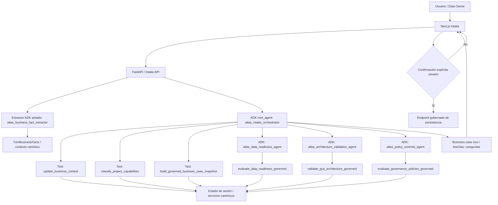
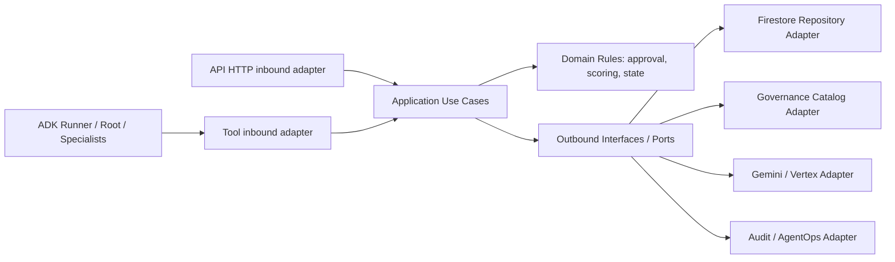
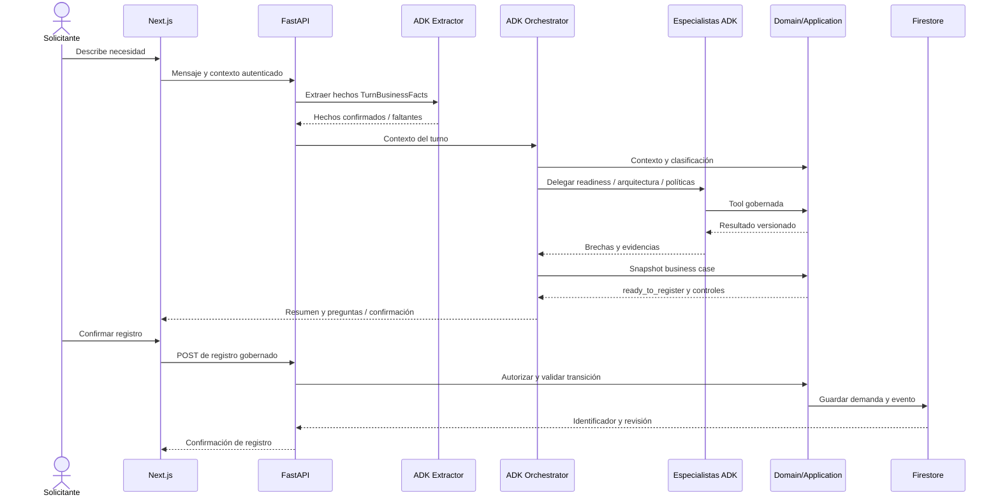

# SDD 08 — Implementación agéntica con Google ADK (baseline DataGob)
**Decisión:** agentes programados con Google Agent Development Kit (ADK), sobre GCP y arquitectura interna Hexagonal Slice. No es una simulación de agentes basada únicamente en diagramas.

## Fuentes de implementación comprobadas
- [Orquestador ADK real](https://github.com/JuliusCordova/portafoliodatagob/blob/main/apps/api/src/atlas_datagob/agents/agent.py): clase `google.adk.agents.Agent`, `root_agent=atlas_intake_orchestrator`, tres subagentes especializados en single-turn.
- [Extractor de hechos de negocio](https://github.com/JuliusCordova/portafoliodatagob/blob/main/apps/api/src/atlas_datagob/agents/business_fact_extractor_agent.py): agente aislado con schema Pydantic `TurnBusinessFacts`.
- [Clasificación](https://github.com/JuliusCordova/portafoliodatagob/blob/main/apps/api/src/atlas_datagob/agents/semantic_classification_tool.py) y [tools gobernadas](https://github.com/JuliusCordova/portafoliodatagob/blob/main/apps/api/src/atlas_datagob/agents/governed_specialist_tools.py).
- [Shell determinista anterior](https://github.com/JuliusCordova/portafoliodatagob/blob/main/apps/api/src/atlas_datagob/agents/policy_intake_agent.py): es un flujo determinista, no confundir con subagente ADK.

## Mermaid 1 — Topología ADK real como referencia

El **root_agent** no persiste la demanda: genera recomendaciones/snapshot; el endpoint gobernado registra únicamente tras confirmación. El extractor opera en runner separado. Subagentes ejecutan tools y reportan resultados, pero no aprueban ni deciden.

## Mermaid 2 — Relación ADK con hexágonos

Regla: ADK es orquestación/adaptador, nunca sustituto de reglas de dominio. Agente y tool deben respetar identidad y autorización; el contrato tool→use case debe ser tipado, auditable e idempotente cuando escribe estado.

## Mermaid 3 — Secuencia de intake gobernado

## Mapa de agentes: real vs catálogo conceptual
| Categoría | Componente | Estado de evidencia |
|---|---|---|
| ADK root | atlas_intake_orchestrator | **Definido en código** |
| ADK especialista | atlas_data_readiness_agent | **Definido en código** |
| ADK especialista | atlas_architecture_validation_agent | **Definido en código** |
| ADK especialista | atlas_policy_controls_agent | **Definido en código** |
| ADK auxiliar | atlas_business_fact_extractor | **Definido en código como runner separado** |
| Funcionalidad | clasificación y snapshot | **Tools del orquestador, no subagentes ADK independientes** |
| Catálogo conceptual | Scoring Agent, Committee Pack, MVP Gate, Portfolio Insights | **Diseño de capacidades en docs/specs/02-agent-map.md; no afirmar que sean subagentes ADK del root** |

## Contratos del estado agéntico
Input/output del extractor: `TurnBusinessFacts {business_problem,desired_outcome,business_area,impacted_process,current_situation,stakeholders[],success_metrics[],data_sources[]}`. Especialistas deben emitir resultado estructurado con tipo, versión de catálogo, evidencias y brechas. Los campos exactos de persistencia se validan contra código y contrato de DataGob, no se inventa endpoint.

## Configuración y ejecución
El código fuente usa `ATLAS_INTAKE_MODEL` con valor predeterminado `gemini-2.5-flash` y un `ATLAS_INTAKE_EXTRACTOR_MODEL` opcional. No hardcodear proyecto ni credenciales. Desplegar con IAM, secretos y configuración apropiada de Vertex. La selección de modelo efectivo se verificará en runtime.

## Verificación para Semana 6
- [ ] Runner ADK y tools integrados con API.
- [ ] LLM prompts/versiones registrados.
- [ ] Cuotas, timeouts, protección prompt injection y tests de permisos.
- [ ] Evals de extracción, readiness, arquitectura y políticas, con casos positivos/negativos.
- [ ] Demanda persistida solo tras confirmación.
- [ ] Evidencia de Cloud Run revision, Git SHA y evaluación con datos sintéticos.
