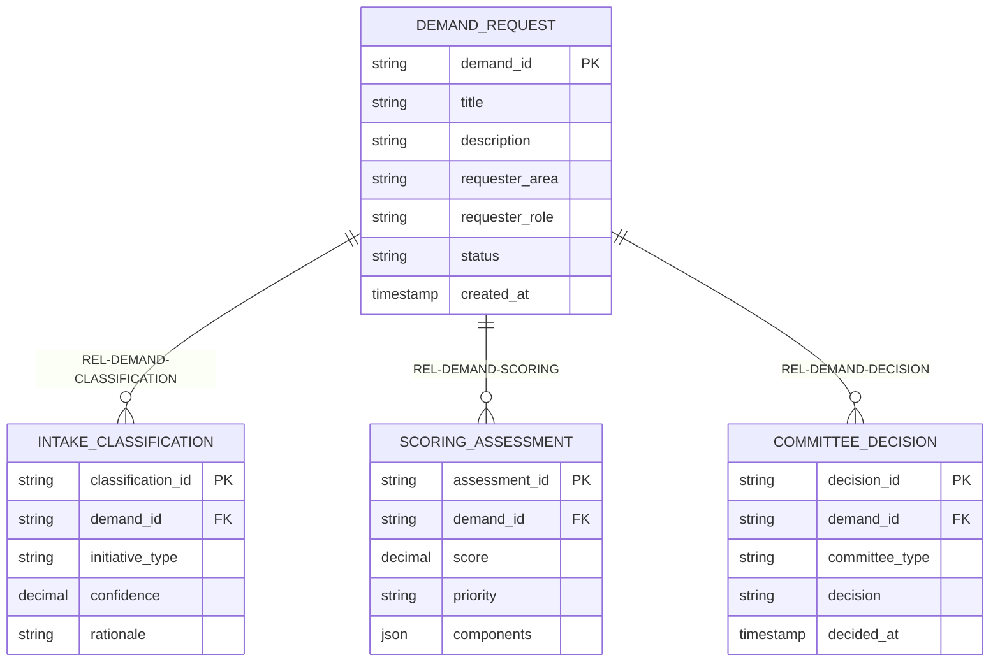
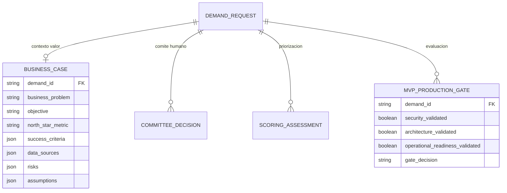
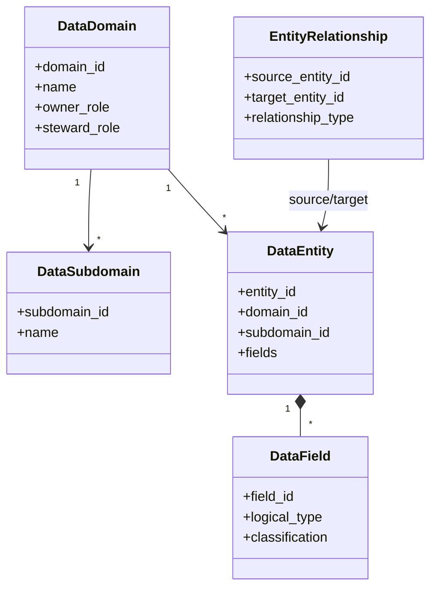
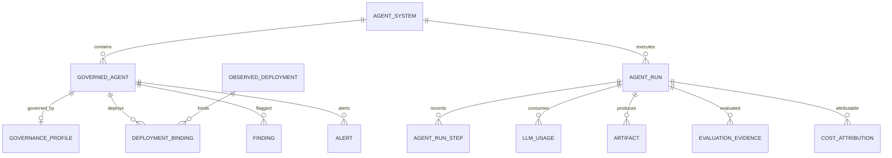

# SDD 09 — Modelo de datos y metadatos heredado de DataGob
**Objetivo:** reutilizar **contratos canónicos exactos** y diferenciarlos del esquema lógico ampliado propuesto en [SDD 02](02-CONTRATOS-Y-DATOS.md). Los JSON y SQL bajo `modelos/` se copiaron del repositorio técnico como snapshots sin modificaciones (salvo archivo de relaciones no replicado por restricción del conector: ver enlace directo).

## 1. Inventario de fuentes y versiones
| Documento UPN | Fuente técnica | Evidencia |
|---|---|---|
| [Diccionario](../modelos/canonical/data_dictionary.json) | [data_dictionary.json](https://github.com/JuliusCordova/portafoliodatagob/blob/main/data/canonical/data_dictionary.json) | v0.3.0, 4 entidades |
| Relaciones | [entity_relationship_model.json](https://github.com/JuliusCordova/portafoliodatagob/blob/main/data/canonical/entity_relationship_model.json) | v0.3.0, 3 relaciones; fuente referenciada |
| [Dominios](../modelos/catalogos/domains.json) | [domains.json](https://github.com/JuliusCordova/portafoliodatagob/blob/main/data/synthetic/domains/domains.json) | catálogo de 3 dominios |
| [Políticas](../modelos/catalogos/policies.json) | [catalog.json](https://github.com/JuliusCordova/portafoliodatagob/blob/main/data/governance/policies/catalog.json) | catálogo de políticas versionadas |
| [Patrones GCP](../modelos/catalogos/architecture_patterns.json) | [catalog.json](https://github.com/JuliusCordova/portafoliodatagob/blob/main/data/governance/architecture_patterns/catalog.json) | catálogo de patrones aprobados |
| [Contrato AgentOps](../modelos/agentops/agentops_contract_v1.json) | [agentops_contract_v1.json](https://github.com/JuliusCordova/portafoliodatagob/blob/main/data/agent_governance/agentops_contract_v1.json) | contrato atlas.agentops.v1, versión 1.1.0 |
| [Esquema analítico AgentOps](../modelos/agentops/bigquery_schema_v1.sql) | [bigquery_schema_v1.sql](https://github.com/JuliusCordova/portafoliodatagob/blob/main/data/agent_governance/bigquery_schema_v1.sql) | DDL **opcional**, no desplegar BigQuery por defecto |

## 2. Mermaid ER — Modelo canónico v0.3.0 exacto

Las tres cardinalidades son **uno a muchos** (clasificaciones reevaluadas, scores múltiples y decisiones de comités). Esta proyección ER reproduce los campos del diccionario 0.3.0; no incluye campos extendidos del documento conceptual.

## 3. Modelo lógico conceptual ampliado (NO igual al diccionario v0.3.0)
[Modelo conceptual DataGob](https://github.com/JuliusCordova/portafoliodatagob/blob/main/docs/specs/03-domain-model.md) añade `BusinessCase`, `MvpProductionGate`, valores de negocio, ROI, criterios, riesgos, dependencias, actas y soporte. Estos son contratos propuestos de evolución, NO cuatro nuevas colecciones verificadas del canónico.

Estos campos son **documentales/conceptuales** y deben cotejarse con DTO, adaptadores Firestore y OpenAPI antes de migrar/escribir.

## 4. Metamodelo de gobierno de datos
[Dominio Python canónico](https://github.com/JuliusCordova/portafoliodatagob/blob/main/apps/api/src/atlas_datagob/domain/canonical.py):
- `DataDomain{domain_id,name,description,owner_role,steward_role,subdomains[]}`
- `DataSubdomain{subdomain_id,name,description,owner_role,steward_role}`
- `DataEntity{entity_id,name,domain_id,subdomain_id,description,fields[],source_systems[],tags[]}`
- `DataField{field_id,name,logical_type,description,required,primary_key,foreign_key,classification,examples[]}`
- `EntityRelationship{relationship_id,source_entity_id,target_entity_id,relationship_type,source_field_id,target_field_id,description}`
- `DataDictionary{version,entities[]}`; `EntityRelationshipModel{version,relationships[]}`.
Clasificación: `public,internal,confidential,restricted`. Tipos: `string,integer,decimal,boolean,date,timestamp,json`. Relaciones: `one_to_one,one_to_many,many_to_one,many_to_many`.

## 5. Modelo de metadata Agent Governance & AgentOps v1.1.0
El contrato copiado define identidades correlacionadas `agent_system_id, agent_id, environment, deployment_id, run_id, trace_id, session_id`. Entidades **del contrato** (no afirmar persistencia real de todas):
- Catálogo y gobierno: `AgentSystem, GovernedAgent, GovernanceProfile, ObservedDeployment, DeploymentBinding`.
- Ejecución: `AgentRun, AgentRunStep, LLMUsage`.
- Evidencias: `Artifact, EvaluationEvidence, Finding, Alert, HealthSnapshot, CostAttribution`.
- Privacidad por defecto: no persistir prompts/respuestas completas y preferir referencias/hashes.

Relaciones AgentOps **derivadas lógicamente de las claves del contrato**; no son claves foráneas físicas que el JSON garantice.

## 6. Persistencia para seis semanas
**Operacional:** Firestore para demandas, clasificaciones, scores, decisiones, revisiones y auditoría. Las entidades/metadatos pueden mapearse a colecciones/subcolecciones según accesos y coste. **Agentes:** ADK session state; resultados de herramientas estructurados; correlación con run/trace. **Catalogación:** snapshots JSON versionados en repo/carga validada. **Analítica AgentOps:** SQL BigQuery de referencia **documental y opcional**, no crear datasets ni cobros sin justificación.

## 7. Reglas de calidad de metadatos
Cada entidad tiene ID estable, versión, owner, clasificación, linaje de origen; campos requeridos y tipos validados. IDs de política/patrón y vigencia son provenientes de catálogos, nunca invención del LLM. Operaciones append-only de decisiones y auditoría; repetir procesamientos debe ser idempotente. Las estadísticas financieras y de demanda son datos simulados de UPN.

## 8. Conciliación con SDD previo
El [SDD 02](02-CONTRATOS-Y-DATOS.md) contiene un esquema **objetivo de piloto** (tenant_id, policy_checks, audit_events, etc.). Este documento distingue estrictamente:
1. **Canónico comprobado**: copias del JSON v0.3.0 y enums Python de DataGob.
2. **Conceptual**: docs/specs/03-domain-model.md del producto.
3. **Propuesta UPN**: extensiones SDD 02 para seguridad, auditoría y contratos.
Antes de desarrollar: tabla field-by-field fuente→DTO→Firestore→API; cambios mediante ADR/migración versionada, sin sobreescribir el canónico.
